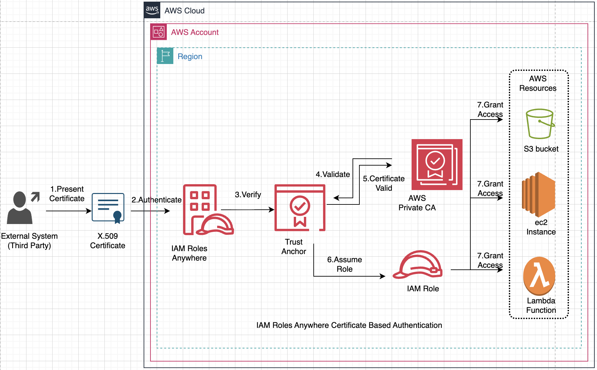

# AWS IAM Roles Anywhere with Private Certificate Authority

This solution automates the deployment of AWS Identity and Access Management Roles Anywhere (IAM Roles Anywhere) with AWS Private Certificate Authority (AWS Private CA). External workloads authenticate with X.509 certificates and receive temporary AWS credentials instead of long-term access keys.

> **Important:** Sample code for non-production use. Do not deploy to production environments without additional security testing and review. See [SECURITY.md](SECURITY.md) for known limitations and production recommendations.

## Architecture



## What This Solution Provides

- **Automated AWS Infrastructure**: AWS CloudFormation template creates an AWS Private CA root CA, an IAM Roles Anywhere trust anchor and profile, and an IAM role
- **Client Certificate Generation**: Automated script generates certificates for external systems
- **Configurable Permissions**: Flexible IAM policy assignment based on your requirements
- **Security-Focused Defaults**: Role trust policy scoped to this stack's trust anchor, account, CA, and allowed client certificate names. This is sample code; review and adapt it to your organization's security requirements before production use

## Prerequisites

### For AWS Infrastructure Deployment
- AWS CLI installed and configured with administrative permissions
- Administrative permissions for IAM, IAM Roles Anywhere, and AWS Private CA

### For Client System Setup
- AWS CLI installed with permissions to:
  - `acm-pca:IssueCertificate`
  - `acm-pca:GetCertificate`
- OpenSSL installed on the client system

## Quick Start

### Step 1: Deploy AWS Infrastructure

```bash
aws cloudformation deploy \
    --template-file iam-roles-anywhere-infrastructure.yml \
    --stack-name my-roles-anywhere \
    --parameter-overrides \
        ProjectName="MyCompany" \
        IAMPolicyArns="arn:aws:iam::aws:policy/AmazonS3ReadOnlyAccess" \
    --capabilities CAPABILITY_NAMED_IAM
```

### Step 2: Get Stack Outputs

```bash
# Get the ARNs from your deployed stack
CA_ARN=$(aws cloudformation describe-stacks --stack-name my-roles-anywhere --query 'Stacks[0].Outputs[?OutputKey==`PrivateCAArn`].OutputValue' --output text)
TRUST_ANCHOR_ARN=$(aws cloudformation describe-stacks --stack-name my-roles-anywhere --query 'Stacks[0].Outputs[?OutputKey==`TrustAnchorArn`].OutputValue' --output text)
PROFILE_ARN=$(aws cloudformation describe-stacks --stack-name my-roles-anywhere --query 'Stacks[0].Outputs[?OutputKey==`ProfileArn`].OutputValue' --output text)
ROLE_ARN=$(aws cloudformation describe-stacks --stack-name my-roles-anywhere --query 'Stacks[0].Outputs[?OutputKey==`RoleArn`].OutputValue' --output text)
```

### Step 3: Setup Client Certificate

```bash
# Make script executable
chmod +x setup-client.sh

# Run client setup
./setup-client.sh \
    --ca-arn $CA_ARN \
    --trust-anchor-arn $TRUST_ANCHOR_ARN \
    --profile-arn $PROFILE_ARN \
    --role-arn $ROLE_ARN
```

### Step 4: Test the Setup

```bash
# Navigate to the created client directory
cd iam-roles-anywhere-client-*

# Test credentials
./test-credentials.sh
```

## Configuration Options

### IAM Policy Examples

**Read-Only Access (Default):**
```bash
--parameter-overrides IAMPolicyArns="arn:aws:iam::aws:policy/ReadOnlyAccess"
```

**S3 Access Only:**
```bash
--parameter-overrides IAMPolicyArns="arn:aws:iam::aws:policy/AmazonS3ReadOnlyAccess"
```

**Multiple Policies:**
```bash
--parameter-overrides IAMPolicyArns="arn:aws:iam::aws:policy/AmazonS3ReadOnlyAccess,arn:aws:iam::aws:policy/AmazonEC2ReadOnlyAccess"
```

### CloudFormation Parameters

| Parameter | Description | Default |
|-----------|-------------|---------|
| `ProjectName` | Name prefix for all resources | `MyRolesAnywhere` |
| `CertificateValidityYears` | Root CA certificate validity (1-10 years) | `3` |
| `SessionDurationSeconds` | Max session duration (900-43200 seconds) | `3600` |
| `IAMPolicyArns` | Comma-separated IAM policy ARNs | `ReadOnlyAccess` |
| `AllowedClientCommonNamePattern` | Client certificate Subject CN (exact value or `*` pattern) allowed to assume the role. Must match the `--client-name` passed to `setup-client.sh`. | `client-*` |

### Role Trust Policy

The IAM role created by the template can only be assumed through IAM Roles Anywhere when all of the following are true:

- `aws:SourceArn` is the trust anchor created by this stack
- `aws:SourceAccount` is the account the stack is deployed in
- `aws:PrincipalTag/x509Issuer/CN` is this stack's private CA (`<ProjectName>-RootCA`)
- `aws:PrincipalTag/x509Subject/CN` matches `AllowedClientCommonNamePattern`

This prevents IAM Roles Anywhere from acting as a [confused deputy](https://docs.aws.amazon.com/IAM/latest/UserGuide/confused-deputy.html) for other trust anchors or profiles that reference the role. For production use, set `AllowedClientCommonNamePattern` to the exact CN of each workload (for example, `payments-batch-01`) instead of a broad wildcard. See [Trust model in IAM Roles Anywhere](https://docs.aws.amazon.com/rolesanywhere/latest/userguide/trust-model.html).

## Using the Credentials

Once setup is complete, your external system can get temporary AWS credentials:

```bash
# Get credentials (returns JSON with AccessKeyId, SecretAccessKey, SessionToken)
./get-credentials.sh

# Or use in your application
CREDS=$(./get-credentials.sh)
export AWS_ACCESS_KEY_ID=$(echo "$CREDS" | jq -r '.AccessKeyId')
export AWS_SECRET_ACCESS_KEY=$(echo "$CREDS" | jq -r '.SecretAccessKey')
export AWS_SESSION_TOKEN=$(echo "$CREDS" | jq -r '.SessionToken')

# Now use AWS CLI or SDKs normally
aws s3 ls
```

## Security Best Practices

- **Rotate certificates regularly** (recommended: annually)
- **Use least-privilege IAM policies** for your specific use case
- **Store private keys securely** on client systems (never share or commit)
- **Monitor certificate expiration** and implement renewal processes
- **Enable CloudTrail logging** for audit trails
- **Use separate CAs** for different environments (dev/prod)

## Troubleshooting

### Common Issues

**"ValidationException: Error creating TrustAnchor"**
- Ensure the AWS Private CA certificate authority is in ACTIVE status
- Verify you have proper permissions for IAM Roles Anywhere

**"Permission denied" when running scripts**
- Run `chmod +x setup-client.sh` to make script executable

**"Certificate validation failed"**
- Check that client certificate was issued by the trusted CA
- Verify certificate hasn't expired

**"Access denied" errors**
- Verify IAM role permissions match your use case
- Check trust policy configuration
- Confirm the client certificate CN (`--client-name`) matches the stack's `AllowedClientCommonNamePattern`
- Confirm you're using the trust anchor and profile from the same stack as the role

## Cleanup

AWS Private CA charges a monthly fee for each certificate authority while it exists, prorated for partial months. Delete the resources when you no longer need them. See [AWS Private CA pricing](https://aws.amazon.com/private-ca/pricing/).

1. Delete the local client directories. They contain unencrypted private keys.

   ```bash
   rm -rf ./iam-roles-anywhere-*/
   ```

2. Delete the CloudFormation stack. This removes the IAM role, the IAM Roles Anywhere trust anchor and profile, and the AWS Private CA certificate authority.

   ```bash
   aws cloudformation delete-stack --stack-name my-roles-anywhere
   aws cloudformation wait stack-delete-complete --stack-name my-roles-anywhere
   ```

3. Confirm the certificate authority status is `DELETED`. Run this with the `CA_ARN` value from Step 2 of the Quick Start.

   ```bash
   aws acm-pca describe-certificate-authority \
       --certificate-authority-arn "$CA_ARN" \
       --query 'CertificateAuthority.Status' --output text
   ```

   A deleted certificate authority stays restorable for a restoration period and is permanently deleted after that. You are not charged for it while it is in the `DELETED` state. If you restore it, you are charged for the time it was deleted.

## Files Description

- `iam-roles-anywhere-infrastructure.yml` - CloudFormation template for AWS resources
- `setup-client.sh` - Automated client certificate generation and setup
- `arch_diagram.png` - Solution architecture diagram

## Security

See [SECURITY.md](SECURITY.md) for known limitations, production recommendations, and how to report a security issue. See [CONTRIBUTING](CONTRIBUTING.md#security-issue-notifications) for more information.

## Contributing

See [CONTRIBUTING.md](CONTRIBUTING.md) and [CODE_OF_CONDUCT.md](CODE_OF_CONDUCT.md).

## License

This library is licensed under the MIT-0 License. See the [LICENSE](LICENSE) file.

---

**Need help?** Check the [AWS IAM Roles Anywhere documentation](https://docs.aws.amazon.com/rolesanywhere/latest/userguide/) for additional guidance.
